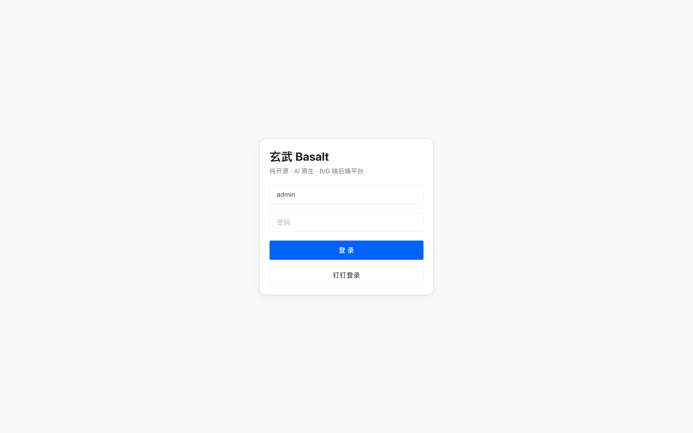
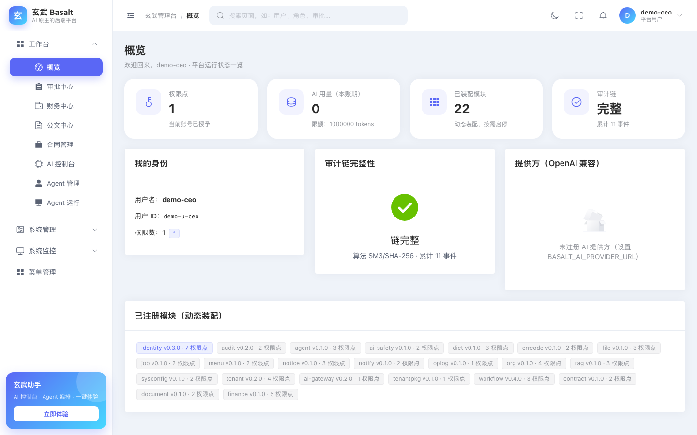
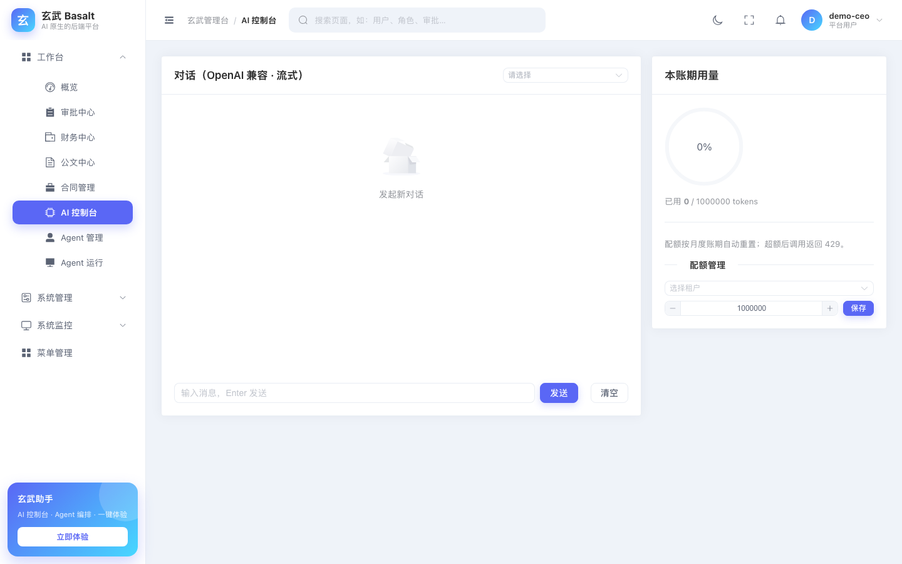
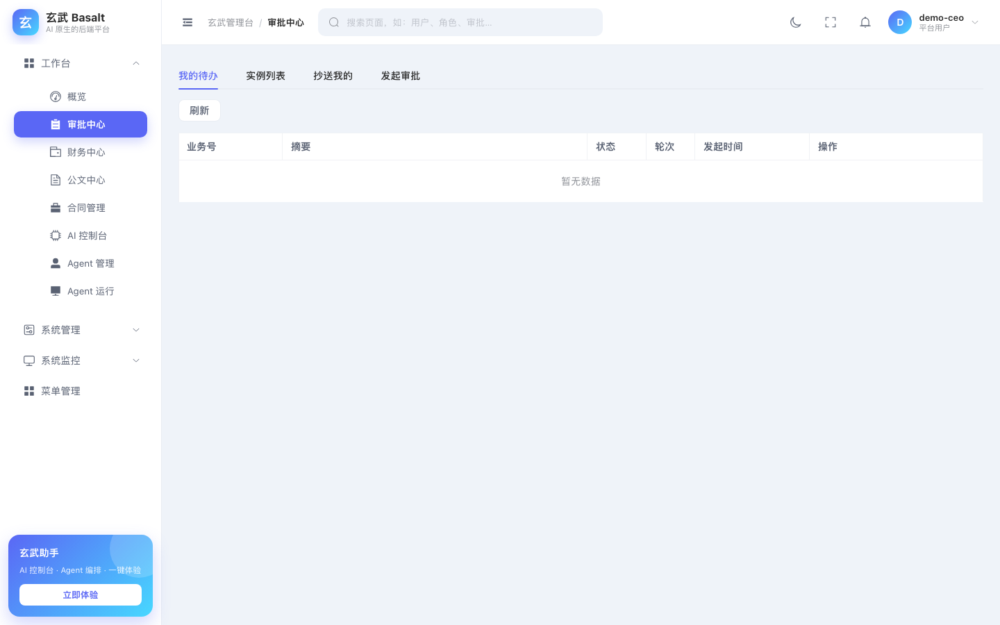
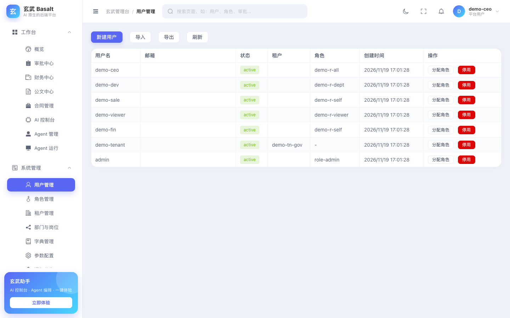

# Basalt

> **AI-native backend platform for B2B & GovTech** — Pure Go · Single static binary · Apache-2.0
> [简体中文](README.zh-CN.md) · [Docs](docs/) · [Changelog](CHANGELOG.md)

> **Naming note**: the repository directory is `AiGoAdmin` (legacy working codename); the official project name is **Basalt**, Go module `github.com/basalt-go/basalt`.

[   ](https://github.com/basalt-go/basalt/releases)

---

## Visual Tour

<p align="center">
  <a href="docs/assets/screenshots/login.png" title="Login — brand gradient left, form right">
    
  </a>
  <a href="docs/assets/screenshots/dashboard.png" title="Overview — 4 stat cards, page header">
    
  </a>
</p>

<p align="center">
  <a href="docs/assets/screenshots/ai-console.png" title="AI Console — chat + SSE streaming + RAG">
    
  </a>
  <a href="docs/assets/screenshots/approvals.png" title="Approvals — 2-step workflow with conditions">
    
  </a>
  <a href="docs/assets/screenshots/users.png" title="User management — RBAC + data scope">
    
  </a>
</p>

---

## Why Basalt

| Differentiator | What you get |
|---------------|--------------|
| **AI governance, built in** | OpenAI-compatible gateway with tenant-level monthly token quotas and atomic metering, full AI call auditing, content safety (reject / replace / mark) — governance is native, not an add-on |
| **Compliance by default** | Tamper-evident audit chain (hash chaining against single-point tampering, chain-head SM2 signatures against full-history recomputation), SM3 digest (GB/T 32905) + SM2 signing (GB/T 32918.2) with official test-vector verification, `secure --check` compliance self-audit |
| **Xinchuang-ready** | Cross-compilation matrix for Kylin/UOS on Kunpeng (arm64) and LoongArch (loong64) in CI; DM / openGauss / OceanBase via the OpenDB injection seam; single static binary (CGO-free SQLite) for offline air-gapped delivery |
| **Tenant database isolation** | Row-level isolation plus **dedicated-db** mode: request-level routing of 14 business modules to per-tenant databases, credentials injected via environment variables (never stored), strict fail-closed semantics |
| **Agent + RAG out of the box** | Lightweight agent orchestration (definition → run → tool loop → SSE events) with LLM calls always routed through the gateway (quota / safety / metering / audit), and RAG search as a built-in tool |
| **Single-binary delivery** | Admin console (Vue 3 + TypeScript + Element Plus) embedded via `go:embed` — one executable, no JVM, no Node runtime in production |
| **Pure open source** | Every feature under a single Apache-2.0 license, no withheld "commercial edition" — see the [Open Source Pledge](OPEN_SOURCE_PLEDGE.md) |

---

## Quickstart (5 minutes)

```bash
# Requires Go >= 1.26
make build

# Seed demo dataset (idempotent, sqlite only; prod refused without --force)
#   org tree, data-scope roles, 6 cross-dept users, dictionaries, notices,
#   tenant + package, finance/document/contract, knowledge base, agent defs,
#   notify templates, 2-step approval flow.
#   Demo accounts share password Demo@2026:
#   demo-ceo / demo-dev / demo-sale / demo-viewer / demo-fin / demo-tenant
BASALT_STORAGE=sqlite BASALT_DB_DSN=/tmp/basalt.db ./bin/basalt seed --demo

# Start → http://localhost:8080, sign in as demo-ceo / Demo@2026
BASALT_STORAGE=sqlite BASALT_DB_DSN=/tmp/basalt.db ./bin/basalt serve
```

The first bootstrapped admin account is `admin / Basalt@2026` (**must** be overridden via env in production — the prod guard refuses default credentials).

Production topology:

```bash
BASALT_STORAGE=sqlite \                      # 22 modules persisted (incl. workflow, notify, menus)
BASALT_DB_DSN=/var/lib/basalt/basalt.db \
BASALT_CRYPTO_ALGO=sm3 \                     # audit chain digest → SM3
BASALT_AI_PROVIDER_URL=http://vllm:8000 \    # any OpenAI-compatible endpoint
BASALT_AI_PROVIDER_KEY=sk-xxx \
  basalt serve --env prod
```

Deployment guide (single binary / Docker) and full env var reference (26 vars with defaults) in [docs/deploy.md](docs/deploy.md) and [.env.example](.env.example).

---

## Architecture

```
L3  Web console (Vue3 + TS + Element Plus, go:embed)                   console/
L2  AI gateway · quota · audit · safety · RAG · agent  pkg/ai/ + pkg/modules/
L1  identity · tenant · workflow · audit · business suite      pkg/modules/
L0  HTTP · config · logging · SM crypto · CLI                    pkg/kernel/
    Cross-cutting: Xinchuang · deployment · security
```

Details: [docs/01-architecture.md](docs/01-architecture.md).

---

## Module Overview

All modules ship with **two assembly paths** — GORM persistence (sqlite) and in-memory zero-dependency mode (`BASALT_STORAGE=sqlite|memory`) — locked by a serve-level full-assembly smoke test.

| Layer | Module | Capabilities | Version |
|-------|--------|--------------|---------|
| L0 | kernel | Module system (dependency-topology lifecycle), gin router abstraction, config, slog, OTel observability, **SM2/SM3 crypto provider** (official test vectors), data-permission scope model, CLI (serve/version/new/secure) | ✅ |
| L1 | identity | User/role RBAC, bcrypt, JWT (jti + session registry + kick), wildcard permission middleware, **OAuth2 2.1 / SSO app management** (PKCE, client credentials, rotating refresh, DingTalk social login), **role data scope (5 levels)**, idempotent admin bootstrap, prod credential guard | v0.3 |
| L1 | tenant | Tenant CRUD, per-request tenant context, row-level isolation; **dedicated-db mode** — 14 business modules routed per request, platform modules pinned to the master DB ([docs](docs/tenant-isolation.md)) | v0.2 |
| L1 | audit | **Tamper-evident audit chain** — hash chaining, chain-head SM2 signatures against full-history recomputation, precise tamper localization, multi-algorithm verification across algo switches, GORM persistence with restart continuation | v0.2 |
| L1 | workflow | Lightweight approval flow: count/or-sign, **sequential approval**, delegation/transfer/countersign (add-sign), reject-to-node with round semantics, CC; definitions & instances persisted | v0.2 |
| L1 | org / dict / sysconfig / notice | Org tree + posts (data-scope pruning), dictionaries, runtime KV config, announcements | v0.1 |
| L1 | **notify** | Notification center: SMS / email / in-app inbox; template rendering, credentials via env (never stored), send logs; self-implemented Aliyun SMS signing, SMTP with zero new deps | v0.1 |
| L1 | **menu** | Dynamic menus: CRUD + role binding + permission-filtered tree API, static fallback on empty payload | v0.1 |
| L1 | **tenantpkg** | Tenant packages: menu/permission templates, binding, single-point permission trimming wired into menus | v0.1 |
| L1 | **errcode** | Error-code registry with seeded module codes | v0.1 |
| L1 | file | **S3-compatible multi-cloud driver** — self-implemented SigV4 (zero SDK deps), MinIO/OSS/COS, hybrid legacy routing, presigned URLs ([docs](docs/file-s3.md)) | v0.1 |
| L1 | job | Scheduler: interval + **cron expressions**, dynamic HTTP callback tasks, persisted run logs, restart recovery | v0.1 |
| L1 | finance / document / contract | Expense/payment/invoice/budget (approval-linked, data-scope filtered), official document flow (G2B hallmark), contract lifecycle with expiry scanning | v0.1 |
| L1 | **oplog** | Operation/API logs & runtime metrics — async non-blocking collection, verified user attribution, sampling modes, paged filtering + 90s sliding-window QPS/error-rate | v0.1 |
| L2 | ai-gateway | **OpenAI-compatible model gateway** + SSE streaming (include_usage metering) + tenant monthly quotas (atomic persisted metering) + call auditing; content-safety integrated since v1.2.0 | v0.2 |
| L2 | ai-safety | **AI content safety**: sensitive-word dictionaries, per-tenant policies, reject/replace/mark with strict-by-default fallback | v0.1 |
| L2 | rag | Knowledge bases → documents → chunks → embeddings → similarity search; OpenAI-compatible embeddings, sqlite blob vectors to start, VectorSearcher seam for dedicated vector DBs | v0.1 |
| L2 | agent | **Lightweight agent orchestration**: definitions → runs → tool loop → SSE events; LLM always via the gateway, built-in RAG search tool, ToolRegistry seam for ecosystem tools | v0.1 |
| L3 | console | Admin console: Vue 3 + TS + Element Plus (on-demand import), 32 views — RBAC, dynamic menus, tenant isolation & packages, approvals, audit chain, AI chat, agents, notify center, SSO, sessions, error codes, business modules; embedded via go:embed | v0.1 |

Version details and strategic decisions: [CHANGELOG](CHANGELOG.md).

---

## Documentation

| Doc | Contents |
|-----|----------|
| [CHANGELOG](CHANGELOG.md) | Release history (v1.0.0 → v1.7.0), per-module versions, strategic decisions |
| [docs/01-architecture.md](docs/01-architecture.md) | Layered architecture and design decisions |
| [docs/02-oss-governance.md](docs/02-oss-governance.md) | Open-source governance and dependency policy |
| [docs/03-gap-analysis.md](docs/03-gap-analysis.md) | Competitive gap analysis (vs. yudao × Spring AI × Eino) |
| [docs/deploy.md](docs/deploy.md) | Deployment guide (single binary & Docker) |
| [docs/tenant-isolation.md](docs/tenant-isolation.md) | Tenant DB isolation: modes, boundaries, ops runbook |
| [docs/file-s3.md](docs/file-s3.md) | S3-compatible storage: matrix, hybrid routing, isolation |
| [docs/sm2-ops.md](docs/sm2-ops.md) | SM2 chain-head signing operations |

## CLI

| Command | Description |
|---------|-------------|
| `basalt serve` | Start HTTP server (`--addr`, `--env dev\|test\|staging\|prod`) |
| `basalt version` | Print version |
| `basalt new module <name>` | Scaffold a new module |
| `basalt seed --demo` | Idempotent demo dataset; prod refused (`--force` overrides); sqlite only; password `Demo@2026` |
| `basalt secure --check` | Compliance self-audit: 7 checks, PASS/WARN/FAIL verdicts; exit codes **0/1/2** (CI-friendly) |

## Roadmap

M1–M3 milestones all delivered early: Admin Console (v1.1.0), RAG & content safety (v1.2.0), agent orchestration & dedicated-db isolation (v1.3.0), SM2 signing (v1.4.0), the P0 platform-completeness batch — notify / data permissions / OAuth2+SSO / dynamic menus / job cron / sessions / tenant packages / error codes (v1.6.0) — and the P1a efficiency batch (v1.7.0). Next: gRPC/service governance, SM4/GMTLS. Shared-db isolation and payments are deliberate non-goals.

---

## Contributing & Security

- Contributions: [CONTRIBUTING.md](CONTRIBUTING.md) — DCO sign-off required
- Security: [SECURITY.md](SECURITY.md) — **do not report vulnerabilities via public issues**
- Governance: [GOVERNANCE.md](GOVERNANCE.md) · Code of conduct: [CODE_OF_CONDUCT.md](CODE_OF_CONDUCT.md)

## License

[Apache License 2.0](LICENSE) · Copyright The Basalt Authors.
The "Basalt" name and logo are project trademarks and are not licensed under the code license.
