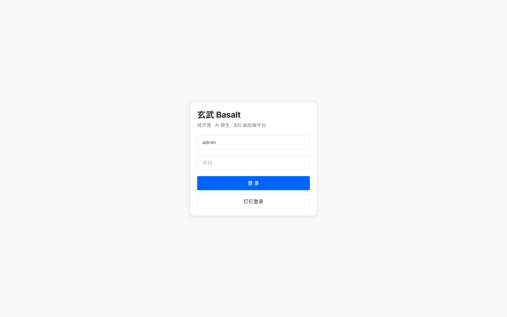
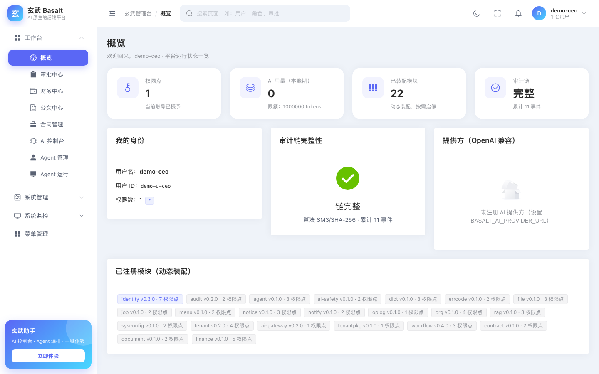
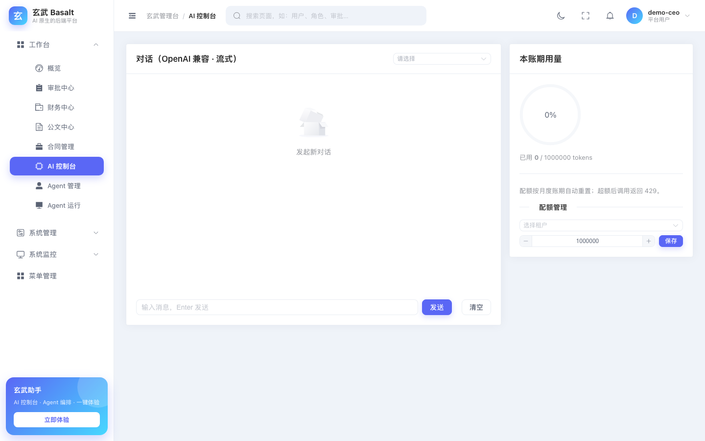
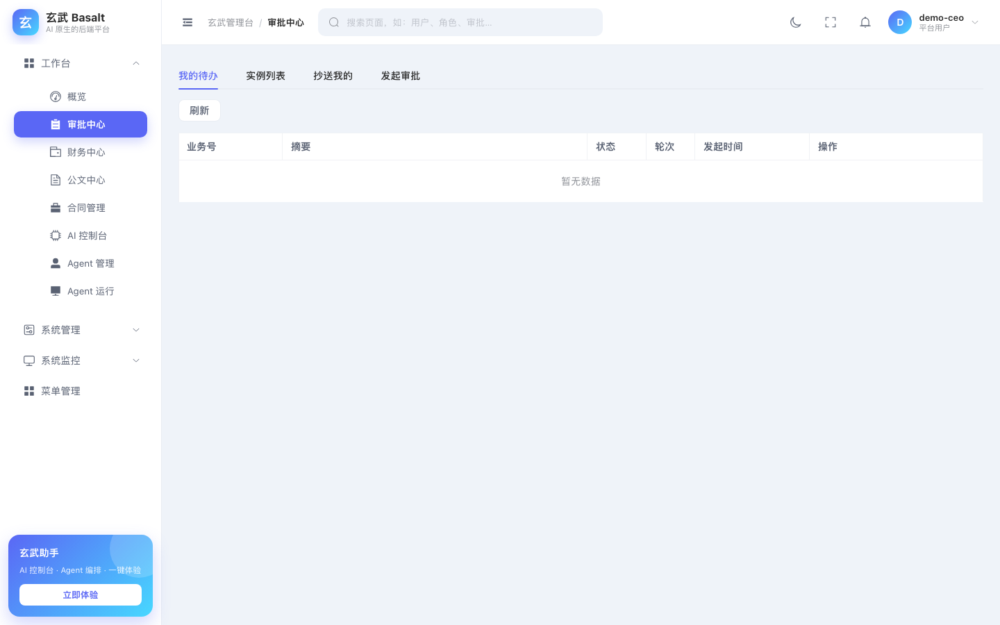
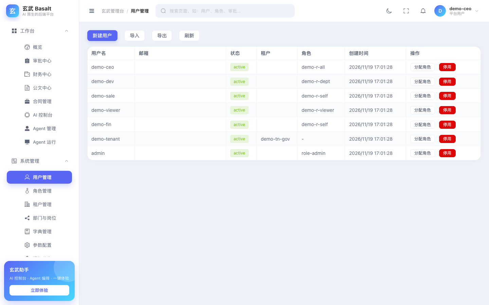

# 玄武 · Basalt

> **为 B 端和政务场景打造的 AI 原生后端平台** —— 纯 Go · 单静态二进制 · Apache-2.0
> [English](README.md) · [文档](docs/) · [更新日志](CHANGELOG.md)

> **命名说明**：仓库目录名 `AiGoAdmin` 为历史开发代号，项目正式名称为 **玄武 Basalt**，Go module 为 `github.com/basalt-go/basalt`。

[   ](https://github.com/basalt-go/basalt/releases)

---

## 可视化速览

<p align="center">
  <a href="docs/assets/screenshots/login.png" title="登录页 · 左品牌渐变 + 右表单">
    
  </a>
  <a href="docs/assets/screenshots/dashboard.png" title="概览页 · 4 张统计卡 + 页头">
    
  </a>
</p>

<p align="center">
  <a href="docs/assets/screenshots/ai-console.png" title="AI 控制台 · 对话 + SSE 流式 + RAG">
    
  </a>
  <a href="docs/assets/screenshots/approvals.png" title="审批流 · 条件网关 + 并行网关">
    
  </a>
  <a href="docs/assets/screenshots/users.png" title="用户管理 · RBAC + 数据权限范围">
    
  </a>
</p>

---

## 为什么选择 Basalt

| 差异化能力 | 你得到什么 |
|-----------|-----------|
| **AI 治理原生内建** | OpenAI 兼容网关 + 租户级月度 Token 配额 + 原子化计量 + 完整 AI 调用审计 + 内容安全（拒绝 / 替换 / 标记）——治理就是骨架，不是外挂 |
| **默认合规** | 防篡改审计链（链式哈希 + SM2 链头签名对抗全历史重算），SM3 摘要 + SM2 签名（GB/T 32905 + GB/T 32918.2）含官方测试向量校验，`secure --check` 合规自检 |
| **信创就绪** | CI 交叉编译覆盖麒麟 / UOS + 鲲鹏 arm64 + 龙芯 loong64；DM / openGauss / OceanBase 通过 OpenDB 注入缝接入；纯 Go 无 CGO SQLite，离线环境单二进制交付 |
| **租户数据库隔离** | 行级隔离 + **独立库模式**：请求级路由将 14 个业务模块分发到各租户专属 DB，凭证走环境变量（不入库），严格 fail-closed 语义 |
| **Agent + RAG 开箱即用** | 轻量 Agent 编排（定义 → 运行 → 工具循环 → SSE 事件），LLM 调用统一走网关（配额 / 安全 / 计量 / 审计），RAG 检索为内建工具 |
| **单二进制交付** | 管理台（Vue 3 + TypeScript + Element Plus）通过 `go:embed` 嵌入 —— 一个可执行文件，生产环境无 JVM、无 Node 运行时 |
| **纯开源** | 所有功能统一 Apache-2.0 许可证，无"商业版"私有功能 —— 见 [开源永恒承诺](OPEN_SOURCE_PLEDGE.md) |

---

## 快速开始（5 分钟）

```bash
# 前置：Go >= 1.26
make build

# 初始化 demo 数据（幂等、仅 sqlite；prod 模式需 --force）
#   组织树 · 数据权限角色 · 6 个跨部门用户 · 字典 · 公告
#   租户 + 套餐 · 财务/文档/合同 · 知识库 · Agent 定义
#   通知模板 · 两步审批流
#   demo 账号默认密码 Demo@2026：
#   demo-ceo / demo-dev / demo-sale / demo-viewer / demo-fin / demo-tenant
BASALT_STORAGE=sqlite BASALT_DB_DSN=/tmp/basalt.db ./bin/basalt seed --demo

# 启动 → http://localhost:8080，使用 demo-ceo / Demo@2026 登录
BASALT_STORAGE=sqlite BASALT_DB_DSN=/tmp/basalt.db ./bin/basalt serve
```

首次启动引导管理员账号 `admin / Basalt@2026`（**生产模式强制用环境变量覆盖默认凭据，prod guard 拒绝默认凭据**）。

生产部署拓扑：

```bash
BASALT_STORAGE=sqlite \                      # 22 个模块持久化（含 workflow、notify、menus）
BASALT_DB_DSN=/var/lib/basalt/basalt.db \
BASALT_CRYPTO_ALGO=sm3 \                     # 审计链摘要 → SM3
BASALT_AI_PROVIDER_URL=http://vllm:8000 \    # 任意 OpenAI 兼容端点
BASALT_AI_PROVIDER_KEY=sk-xxx \
  basalt serve --env prod
```

单二进制 / Docker 部署指南 + 完整环境变量参考（26 个）见 [docs/deploy.md](docs/deploy.md) 和 [.env.example](.env.example)。

---

## 架构

```
L3  管理台（Vue3 + TS + Element Plus，go:embed 嵌入）          console/
L2  AI 网关 · 配额 · 审计 · 安全 · RAG · Agent  pkg/ai/ + pkg/modules/
L1  身份 · 租户 · 工作流 · 审计 · 业务套件       pkg/modules/
L0  HTTP · 配置 · 日志 · SM 国密 · CLI           pkg/kernel/
    横切：信创 · 部署 · 安全
```

详细说明见 [docs/01-architecture.md](docs/01-architecture.md)。

---

## 模块一览

所有模块提供 **两种装配路径** —— GORM 持久化（sqlite）和内存零依赖模式（`BASALT_STORAGE=sqlite|memory`）—— 由 serve 级全装配冒烟测试锁定。

| 层 | 模块 | 能力 | 版本 |
|----|------|------|------|
| L0 | kernel | 模块系统（依赖拓扑生命周期）、gin 路由抽象、配置、slog、OTel 可观测、**SM2/SM3 国密提供者**（官方测试向量）、数据权限范围模型、CLI（serve/version/new/secure） | ✅ |
| L1 | identity | 用户/角色 RBAC、bcrypt、JWT（jti + 会话注册表 + 强制下线）、通配权限中间件、**OAuth2 2.1 / SSO 应用管理**（PKCE、client credentials、轮转 refresh、钉钉社交登录）、**角色数据范围（5 级）**、幂等管理员引导、prod 凭据守卫 | v0.3 |
| L1 | tenant | 租户 CRUD、请求级租户上下文、行级隔离；**独立库模式** —— 14 个业务模块按请求路由，平台模块固定主库 ([docs](docs/tenant-isolation.md)) | v0.2 |
| L1 | audit | **防篡改审计链** —— 链式哈希、链头 SM2 签名对抗全历史重算、精确篡改定位、多算法切换验证、GORM 持久化 + 重启续链 | v0.2 |
| L1 | workflow | 轻量审批流：count/or-sign、**顺序审批**、委派/转交/加签、驳回至节点支持 round 语义、抄送；定义与实例持久化 | v0.2 |
| L1 | org / dict / sysconfig / notice | 组织树 + 岗位（数据权限自动裁剪）、字典、运行时 KV 配置、公告 | v0.1 |
| L1 | **notify** | 通知中心：短信 / 邮件 / 站内信；模板渲染、凭证走环境变量（不入库）、发送日志；自实现阿里云 SMS 签名、SMTP 零新增依赖 | v0.1 |
| L1 | **menu** | 动态菜单：CRUD + 角色绑定 + 权限过滤树 API，空载荷时静态兜底 | v0.1 |
| L1 | **tenantpkg** | 租户套餐：菜单/权限模板、绑定、单点权限裁剪（接入 menus） | v0.1 |
| L1 | **errcode** | 错误码注册表（种子化模块代码） | v0.1 |
| L1 | file | **S3 兼容多云驱动** —— 自实现 SigV4（零 SDK 依赖）、MinIO/OSS/COS、老路径混合路由、预签名 URL ([docs](docs/file-s3.md)) | v0.1 |
| L1 | job | 调度器：interval + **cron 表达式**、动态 HTTP 回调任务、持久化运行日志、重启恢复 | v0.1 |
| L1 | finance / document / contract | 费用/付款/发票/预算（与审批联动、数据权限过滤）、公文流程（G2B 公章场景）、合同生命周期 + 到期扫描 | v0.1 |
| L1 | **oplog** | 操作/API 日志 + 运行时指标 —— 异步非阻塞采集、已验证用户归属、采样模式、分页过滤 + 90s 滑窗 QPS/错误率 | v0.1 |
| L2 | ai-gateway | **OpenAI 兼容模型网关** + SSE 流式（含 include_usage 计量）+ 租户月度配额（原子持久化计量）+ 调用审计；内容安全自 v1.2.0 集成 | v0.2 |
| L2 | ai-safety | **AI 内容安全**：敏感词库、每租户策略、严格默认兜底下的 reject/replace/mark | v0.1 |
| L2 | rag | 知识库 → 文档 → 分块 → Embedding → 相似度检索；OpenAI 兼容 Embedding，sqlite Blob 向量起步，VectorSearcher 注入缝预留独立向量库 | v0.1 |
| L2 | agent | **轻量 Agent 编排**：定义 → 运行 → 工具循环 → SSE 事件；LLM 始终走网关、RAG 检索为内建工具、ToolRegistry 注入缝预留生态工具 | v0.1 |
| L3 | console | 管理台：Vue 3 + TS + Element Plus（按需导入）、32 个视图 —— RBAC、动态菜单、租户隔离与套餐、审批、审计链、AI 对话、Agent、通知中心、SSO、会话、错误码、业务模块；go:embed 嵌入 | v0.1 |

版本细节与战略决策见 [CHANGELOG](CHANGELOG.md)。

---

## 文档索引

| 文档 | 内容 |
|------|------|
| [CHANGELOG](CHANGELOG.md) | 版本历史（v1.0.0 → v1.7.0）、模块版本、战略决策 |
| [docs/01-architecture.md](docs/01-architecture.md) | 分层架构与设计决策 |
| [docs/02-oss-governance.md](docs/02-oss-governance.md) | 开源治理与依赖策略 |
| [docs/03-gap-analysis.md](docs/03-gap-analysis.md) | 竞品差距分析（对比 yudao × Spring AI × Eino） |
| [docs/deploy.md](docs/deploy.md) | 部署指南（单二进制 / Docker） |
| [docs/tenant-isolation.md](docs/tenant-isolation.md) | 租户 DB 隔离：模式、边界、运维 runbook |
| [docs/file-s3.md](docs/file-s3.md) | S3 兼容存储：矩阵、混合路由、隔离 |
| [docs/sm2-ops.md](docs/sm2-ops.md) | SM2 链头签名运维 |

## CLI

| 命令 | 说明 |
|------|------|
| `basalt serve` | 启动 HTTP 服务（`--addr`、`--env dev\|test\|staging\|prod`） |
| `basalt version` | 打印版本 |
| `basalt new module <name>` | 脚手架新模块 |
| `basalt seed --demo` | 幂等 demo 数据；prod 拒绝（`--force` 覆盖）；仅 sqlite；密码 `Demo@2026` |
| `basalt secure --check` | 合规自检：7 项检查，PASS/WARN/FAIL 裁定；退出码 **0/1/2**（CI 友好） |

## 路线图

M1–M3 里程碑全部提前交付：管理台（v1.1.0）、RAG 与内容安全（v1.2.0）、Agent 编排与独立库隔离（v1.3.0）、SM2 链头签名（v1.4.0）、P0 平台完备性批次 —— notify / 数据权限 / OAuth2+SSO / 动态菜单 / job cron / 会话 / tenant pkg / errcode（v1.6.0）、P1a 效率批次（v1.7.0）。下一阶段：gRPC/服务治理、SM4/GMTLS。共享库隔离和支付是刻意放弃的方向。

## License

[Apache License 2.0](LICENSE) · Copyright The Basalt Authors.
"Basalt" 名称与 Logo 为项目商标，不随代码许可证授权。
