# Basalt（玄武）— 项目介绍

> 定位、特性、界面与部署的完整门面文档（README 为简版入口，本文为详版）。
> 状态基线：v1.7.0 · 22 个模块 · 32 个控制台视图 · Apache-2.0。

## 1. 项目定位与背景

Basalt 是一个**纯 Go、AI 原生、面向 ToB/ToG 的通用后端平台框架**，交付形态为内置 Web 控制台的单体静态二进制（API-first）。

它站在三条产品线的交汇处——这个交汇处此前是空白：

| 产品线 | 代表 | Basalt 的取舍 |
|--------|------|---------------|
| 企业级平台基线（RBAC/多租户/工作流/审计） | 芋道 yudao、若依、JeecgBoot | 对齐平台完备性水位，垂直业务域（商城/CRM/ERP）明确不自研、留生态 |
| AI 应用基础设施 | Spring AI、Eino | 只做「平台化封装」：网关/配额/内容安全/审计/编排治理，不重造编排引擎 |
| 合规与信创 | 无成熟对标 | 国密双算法、防篡改审计链、等保自查、国产 OS/CPU/数据库适配——默认开启而非可选项 |

竞品差距的完整分析见 [docs/03-gap-analysis.md](03-gap-analysis.md)。

## 2. 核心特性

1. **AI 治理内建**：OpenAI 兼容模型网关统一入口——租户月度 Token 配额（跨期限额延续、原子记账）、调用成本核算、AI 全链路入审计链；内容安全三动作（reject 拦截 / replace 替换 / mark 观察入链）按租户策略回落（租户 → 平台 → 内置默认从严）。
2. **合规默认**：防篡改审计链纵深防御——链式哈希防单点篡改 → 链尾 SM2 签名防「持有全部数据的攻击者整库重算伪造历史」（私钥不入库）→ 算法切换后多算法逐段核验；`basalt secure --check` 七项等保基线自查，退出码 0/1/2 可直接接入 CI。
3. **信创适配**：麒麟/统信 OS + 鲲鹏（arm64）/龙芯（loong64）交叉编译矩阵在 CI 常态化；达梦/openGauss/OceanBase 经 OpenDB 注入缝接入；CGO-free SQLite 保证单静态二进制可离线交付到无外网环境。
4. **租户库级隔离**：行级隔离之外提供 dedicated-db 模式——14 个业务模块按请求路由到租户专属库（首访懒建库、DSN 凭据仅经环境变量注入不落库、连接失败明确报错绝不静默回退主库）；租户套餐对菜单/权限做单点裁剪。
5. **Agent 与 RAG 开箱**：轻量 Agent 编排（定义 → 运行 → 工具调用循环 → SSE 七类运行事件），LLM 调用一律经网关（配额/内容安全/记账/审计全链路生效）；RAG 完整管道（知识库 → 文档 → 切片 → 向量化 → 相似检索）并作为 Agent 内置工具；不引入重型编排框架，接口缝预留生态对接。
6. **单二进制交付**：Vue3 + TypeScript 控制台经 go:embed 嵌入——生产环境一个可执行文件，无 JVM、无 Node 运行时、无外部数据库强依赖（SQLite 开箱）。
7. **纯开源承诺**：全部功能（含 AI 治理与国密）单一 Apache-2.0 协议，永无闭源「商业版」——见 [OPEN_SOURCE_PLEDGE.md](../OPEN_SOURCE_PLEDGE.md)。

## 3. 功能总览（22 模块）

| 分层 | 模块 | 一句话能力 |
|------|------|-----------|
| L0 内核 | kernel | 模块系统（依赖拓扑生命周期）、Router 抽象、配置/日志/OTel、SM2/SM3 Provider、数据权限 Scope 模型、CLI |
| L1 身份与权限 | identity | RBAC、OAuth2 2.1/SSO（PKCE/客户端凭证/轮换刷新/钉钉三方）、数据权限五档、会话管理与踢下线 |
| L1 租户 | tenant / tenantpkg | 租户 CRUD 与行级+dedicated-db 隔离 / 租户套餐（菜单权限模板裁剪） |
| L1 审计与日志 | audit / oplog | 防篡改审计链（SM2 链尾签名）/ 操作与 API 日志、QPS 与错误率监控 |
| L1 协作 | workflow / notify / notice | 轻量审批流（会签/或签/依次/抄送/转办/委派/加签/驳回至节点）/ 通知中心（短信/邮件/站内信）/ 全员公告 |
| L1 组织与配置 | org / dict / sysconfig / errcode / menu | 部门岗位 / 数据字典 / 运行参数 / 错误码注册表 / 动态菜单（后端下发+静态回退） |
| L1 业务 | finance / document / contract / file / job | 财务（报销付款发票预算）/ 公文流转 / 合同到期督办 / 文件（S3 多云）/ 调度（cron+动态任务+日志） |
| L2 AI 基础设施 | ai-gateway / ai-safety / rag / agent | 模型网关与配额 / 内容安全 / 知识库检索 / Agent 编排 |
| L3 控制台 | console | 32 视图管理台（Vue3 + TS + Element Plus，Semi Design 视觉） |

> 全部模块具备 GORM 持久化与内存零依赖两条装配路径；逐模块版本与能力明细见 [README.zh-CN.md](../README.zh-CN.md) 模块表与 [CHANGELOG](../CHANGELOG.md)。

## 4. 界面预览

以下截图来自 `basalt seed --demo` 演示数据集（demo-ceo 登录态，1440 宽视口）。

### 登录与概览

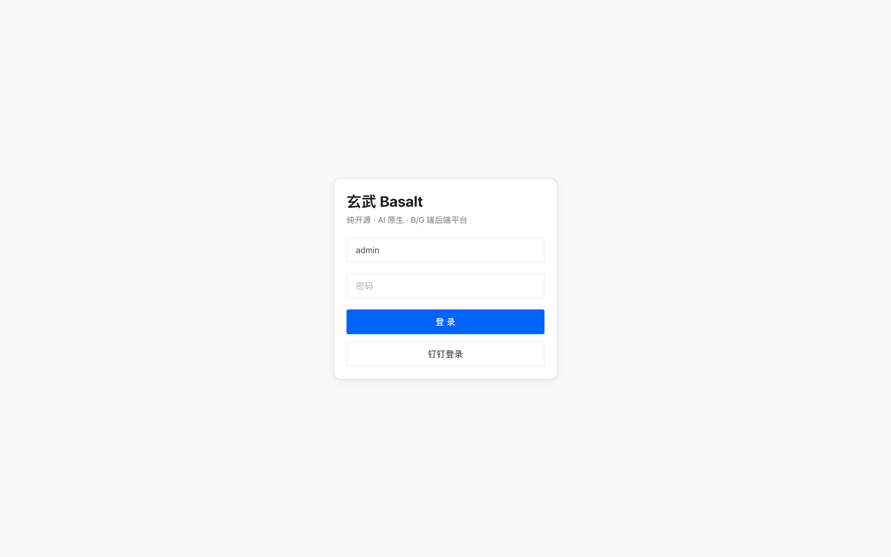

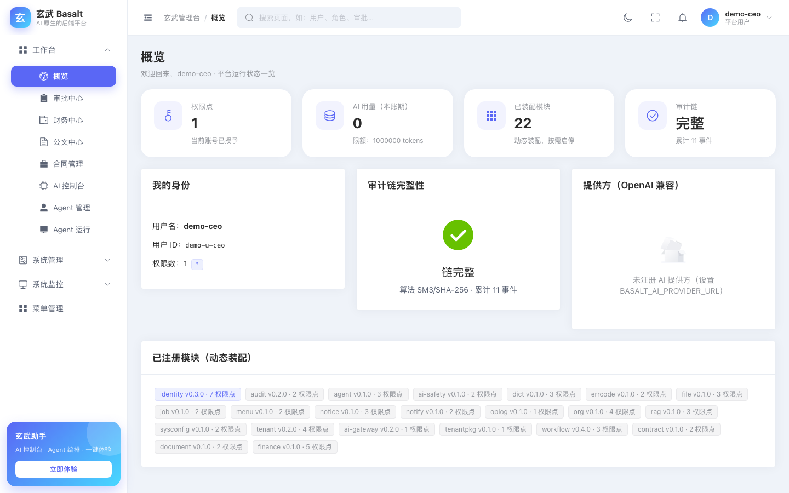

### 身份与权限管理

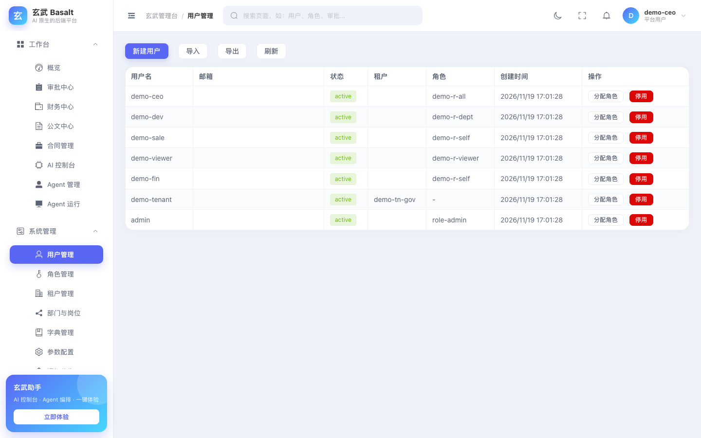

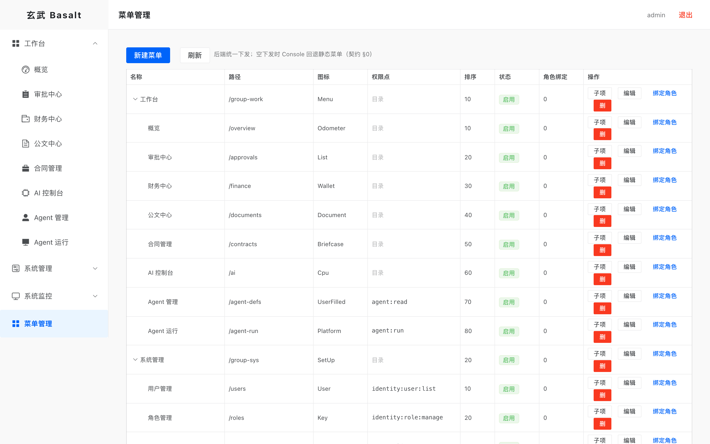

### 审批协作

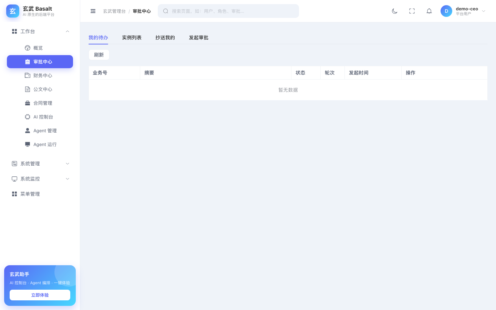

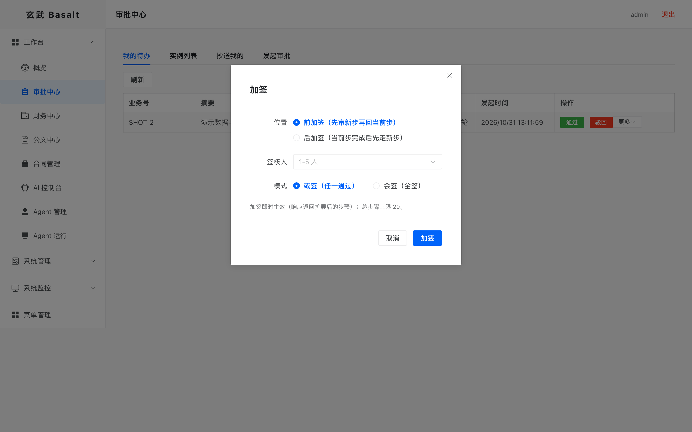

### AI 能力

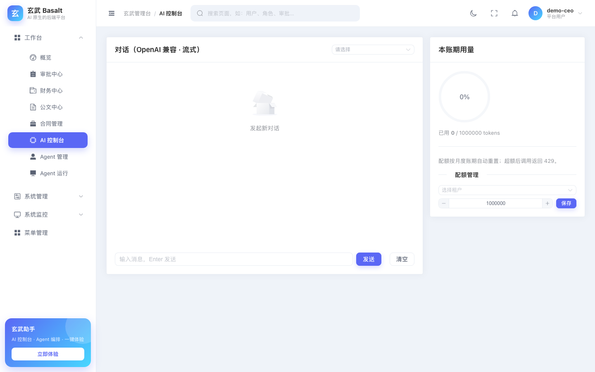

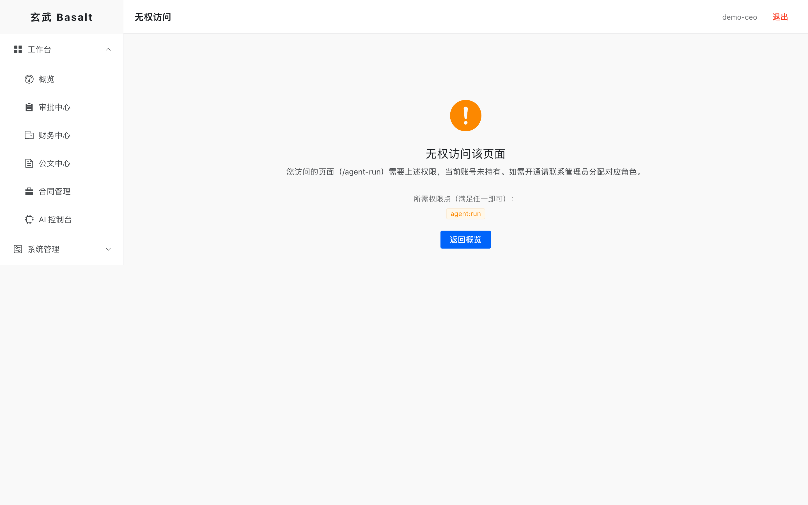

> 知识库（RAG）当前为 API-only（无 Console 页面），经 REST API 管理库/文档/切片并检索。

### 平台治理与租户

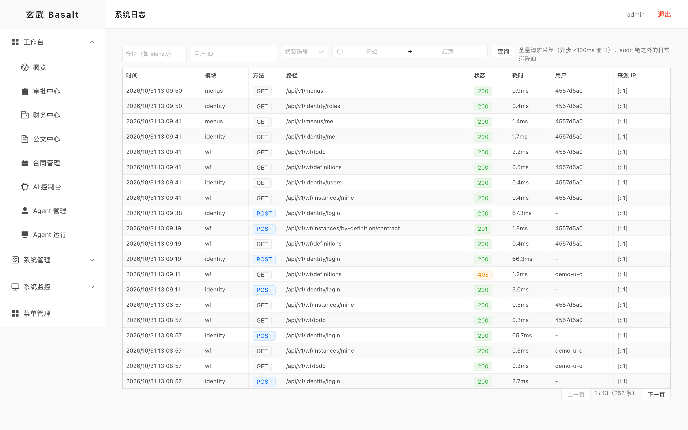

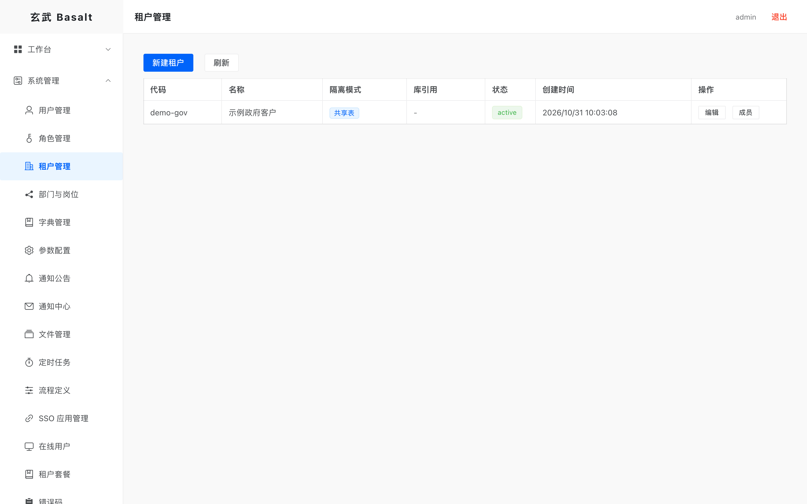

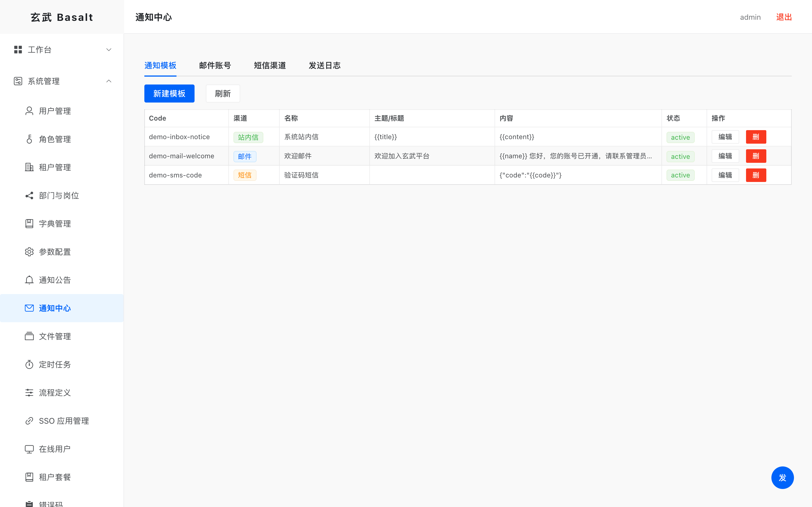

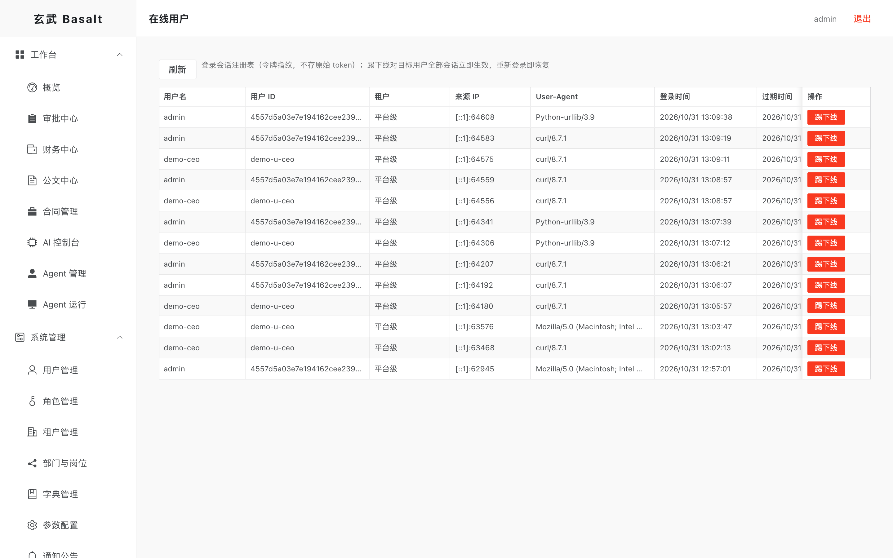

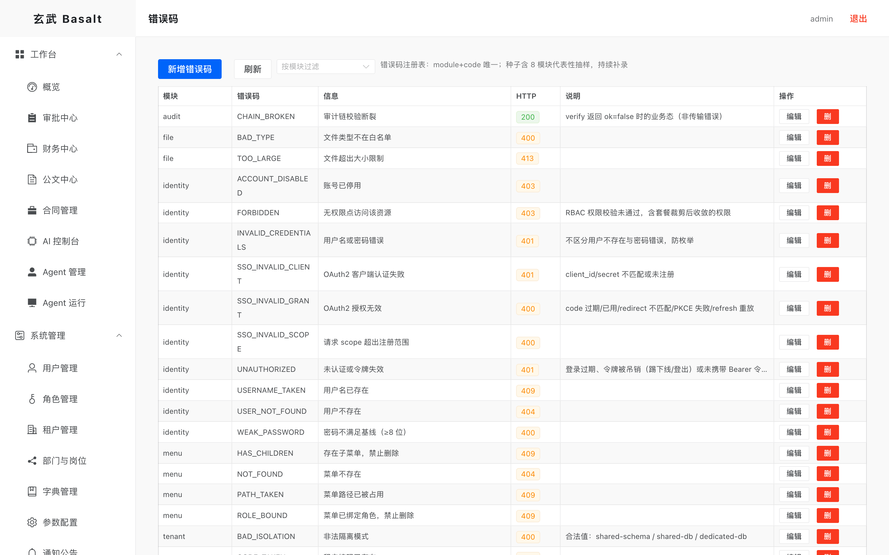

## 5. 部署流程

### 五分钟体验（三条命令）

```bash
make build                                                        # 构建（含版本注入）
BASALT_STORAGE=sqlite BASALT_DB_DSN=/tmp/basalt.db ./bin/basalt seed --demo   # 演示数据（幂等）
BASALT_STORAGE=sqlite BASALT_DB_DSN=/tmp/basalt.db ./bin/basalt serve         # 启动，访问 http://localhost:8080
```

演示账号口令 `Demo@2026`（demo-ceo / demo-dev / demo-sale / demo-viewer / demo-fin / demo-tenant）。

### 生产部署（两条路径）

- **单二进制**：交叉编译产物直接部署；prod 环境强制显式配置 JWT 密钥与引导管理员口令（默认凭据拒绝启动），SQLite 落持久卷；细节（含 systemd 样例与安全清单）见 [deploy.md](deploy.md)。
- **容器**：官方三阶段 Dockerfile（前端构建 → go:embed → alpine 运行时），非 root 用户、`/healthz` 健康检查、`/var/lib/basalt` 持久卷——`docker run` 即得带控制台的完整服务。

全部 26 个环境变量（含 S3 多云存储、租户隔离路由、SM2 签名、AI 提供方、oplog 采样）见 [.env.example](../.env.example)。

## 6. 安全与合规

- **国密双算法**：SM3 摘要（GB/T 32905）与 SM2 签名（GB/T 32918.2）均以官方测试向量验证；审计链哈希与链尾签名可独立切换启用。
- **审计纵深**：哈希链（防单点篡改）→ 链尾 SM2 签名（防整库重算伪造）→ 多算法逐段核验（算法切换不误报）；篡改可精确定位到条目。
- **等保自查**：`basalt secure --check` 七项检查（凭据默认值/加密算法/上传目录/审计链完整性/租户隔离/密钥暴露面/SSO 密钥），三态判定 + CI 友好退出码。
- **安全默认**：prod 守卫拒绝默认凭据启动；DSN/AK-SK/SMTP/短信凭据仅经环境变量注入不落库；JWT 带 jti 支持会话级吊销。

## 7. 适用场景与限制

### 适用场景

- ToB 管理系统底座（多租户 SaaS 或私有化交付）
- ToG 公文流转、审批协作与合规审计场景
- 企业 AI 中台（需要配额、内容安全与全链路审计的模型接入治理）
- 信创私有化环境（离线单文件交付、国产 CPU/OS/数据库）

### 当前限制（如实）

- postgres/openGauss 驱动接线 pending（配置后显式报错并提示回退 sqlite/memory），当前持久化后端为 SQLite
- 工作流为**轻量定位**：无 BPMN 设计器与表单引擎，覆盖高频审批操作子集（含依次/抄送/转办/委派/加签/任意节点驳回），复杂编排非目标
- file 模块文件字节流默认在共享磁盘（元数据已随库隔离），物理隔离随对象存储 bucket 策略接入
- gRPC/微服务形态未开始（单体定位，微服务在路线图）
- shared-db 租户模式与支付系统为**战略非目标**（评估结论与理由见 [tenant-isolation.md](tenant-isolation.md) §4 与 CHANGELOG 战略决策记录）

## 8. 生态与路线图

- **生态边界**：垂直业务域（商城/CRM/ERP/MES 等）不自研，以模块插件机制承接社区与商业生态；新模块经 RFC 流程（`docs/rfcs/`）提案。
- **路线图**（按 [CHANGELOG](../CHANGELOG.md) 与竞品 Gap 分析滚动更新）：代码生成器（OpenAPI 契约驱动三件套）→ P1b 批次（企微/钉钉生态集成、报表图表、WebSocket、会员中心）→ gRPC/服务治理 → SM4/GMTLS。

---

*本文档与 v1.7.0 代码实况对齐；截图由演示环境（seed --demo）生成。*
